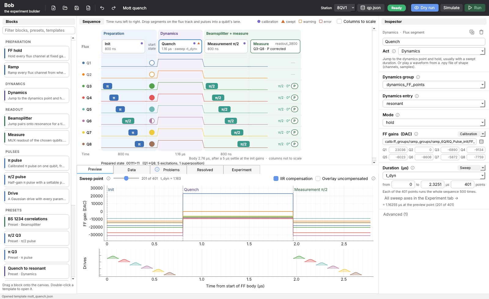
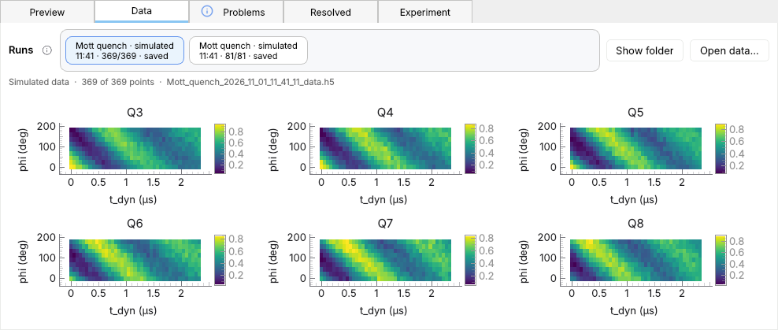

# Bob: block-based experiment builder

I'm building Bob so we can put together triangle-lattice experiments from blocks instead of
writing a new script each time. The flux track runs along the top, with one lane per qubit
below, across three acts: preparation, dynamics, then beamsplitter and measure. Blocks point
into our calibration file instead of copying numbers out of it, so every edit is resolved,
checked and compiled as you make it. Bob imports nothing from outside `Bob/`.



| Works now, offline | Not yet |
|---|---|
| Build, validate, preview, save, dry-run, export to Python. Running, saving and plotting end to end on a **simulated board** | Running on the real RFSoC. The code has never touched it: Run (GUI) and `--run` (scripts) stay off until we finish the [lab checklist](#before-our-first-lab-run) |

## Run it

```bash
git clone https://github.com/houcklab/HouckLab_QICK.git && cd HouckLab_QICK
git checkout agentic_measurement
cd WorkingProjects/triangle_lattice_quench           # always launch from here

conda create -n bob_qsim python=3.12 -y              # first time only
conda activate bob_qsim
python -m pip install -r Bob/requirements.txt        # first time only

python -m Bob.Bob_GUI                                # the GUI
python -m Bob.Bob_GUI Bob/library/templates/mott_quench.json   # open a sequence directly
python -m pytest Bob/tests                           # the tests
```

Use `python -m pip`, not plain `pip`, so the packages go into `bob_qsim`. The same commands work on
macOS, Windows (in the Anaconda Prompt) and Linux, and Bob looks the same on all three. Shortcuts
are written Ctrl+… here; on macOS they are ⌘….

## Using the GUI

| Area | What it does |
|---|---|
| **Blocks** (left) | Drag segments onto the flux track, pulses into a qubit's lane, and Measure into the last column. Double-click a template to open it |
| **Sequence** (center) | Click to select, drag to move, Delete, Ctrl+D / C / V, right-click for more. A purple dot means a field reads calibration; an orange triangle means it is swept. Hover either for the fields |
| **Start state** column | Each qubit's prepared state: ○ \|0⟩, ● \|1⟩, ◐ superposition, ? unknown. It assumes ideal π and π/2 pulses |
| **Measure** chip | Readout group, qubits, and what is reported: P corrected, P raw or IQ. A final π/2 shows its phase, since it sets the measurement basis |
| **Inspector** (right) | Shows where each field comes from: a value, calibration, a sweep, or the previous segment. Typing in one cell overrides just that channel (shown bold). A swept field shows its axis's range, editable right there |
| **Bottom tabs** | Preview waveforms · **Data**: results, drawn as they are measured · Problems · every resolved value and where it came from · Experiment: reps, save folder, all sweep axes with the fields that follow each, and the plain-language summary |
| **Top bar** | Open / save, export (Ctrl+E), undo, rename (click the title), calibration file, Dry run, **Simulate** (Run uses the simulated board), Run (hover it to see why it is off) |

### How sweeps work

A **sweep axis** is a named range, such as `t_dyn` from 0 to 2.3251 µs over 401 points. A field
follows an axis when its source is Sweep. At each point, Bob runs the whole sequence `reps` times
with every field on that axis set to the point's value.

| You want to | Do this |
|---|---|
| Sweep a field | Select its block, set the field's source to **Sweep**, and set the range right under it |
| Move two fields together | Point both at the same axis |
| Make a 2D sweep | Use two axes. Every combination runs, and the first axis is the outer loop |
| See every sweep at once | Open the **Experiment** tab: one row per axis, with the fields that follow it |

## Running, saving and plotting


**Saving.** The `.h5` is created before the first point and filled in as points are measured
(at most a second behind), so a crash, Ctrl+C or Stop keeps everything measured up to then.
Its `status` attribute says how the run ended. Unmeasured points are NaN.

| Data goes to (first match wins) | Set in |
|---|---|
| `--out FOLDER` | The exported script's command line |
| The sequence's save folder | The Experiment tab, or `SAVE_FOLDER` at the top of an exported script |
| The station's `outer_folder` (now `Z:\QSimMeasurements\Measurements\8QV1_Q0V\`) | `station.json` |

The station's folder is a Windows drive path, so on a Mac set a save folder (e.g. where the lab
drive is mounted); Bob says so instead of writing somewhere odd.

Inside it, Bob uses our lab's layout: `<folder>/<name>/<name>_<date>/<name>_<time>_data.h5`.
We haven't checked yet whether our viewer GUI or Desq opens Bob's `.h5`: the names match ours,
the contents differ.

**Each run's `.h5` holds everything needed to run it again**, in its attributes:

| Saved | In the `.h5` | Also beside it, to read |
|---|---|---|
| Results, sweep axes, read-out qubits | Datasets (`population_corrected`, `I`, `Q`, `t_dyn`, …) | `_data.png` |
| The sequence: blocks, settings, summary | `bob_sequence` | `_bob_sequence.json` |
| The station, as it was | `station` | |
| The calibration file it used, whole (or an exported script's frozen subset) | `calibration`, `calibration_sha256` | `_qubit_parameters.json` |
| The IIR coefficient files | `iir/` | |
| Every resolved number at every point: fixed ones once, swept ones as one array each | `resolved/` | `_bob_snapshot.json` (first point) |
| The board's own config (real runs) | `board_config`, `board_config_check` | `_soccfg.json` |
| Bob's version and git commit, start and end time, how the run ended | `bob_version`, `bob_git_commit`, `status`, … | |

```bash
python -m Bob.runner.rerun <run>_data.h5                   # check the saved inputs rebuild every point exactly
python -m Bob.runner.rerun <run>_data.h5 --run             # run it again (or --run --simulate)
python -m Bob.runner.rerun <run>_data.h5 --sequence x.json # get the sequence back, to open in Bob
```

If the station folder holds a reference board config (`library/stations/8QV1/soccfg.json`), each
run's board config is compared with it; a difference (new firmware or `qick` version) is flagged
in the Data tab and recorded in the `.h5`.

**Simulated runs.** Turn on **Simulate** in the top bar (or add `--simulate` to an exported
script's `--run`) to run the whole sequence on a simulated board: no RFSoC, no verified station
needed. It returns single shots in the board's format, drawn from the readout group's
SingleShot data (angle, threshold, readout errors) around a made-up signal, so populations,
saving, Stop, the Data tab and the plots all run for real. It does not check that QICK can
assemble Bob's program; that needs the board config (see the checklist). Simulated runs are
labelled everywhere and saved under `<folder>/_simulated/`.

**Plotting.** No experiment needs its own plotting code. The plot follows the sequence:

| Sweep | Plot (Data tab and exported scripts) |
|---|---|
| No axes | One value per qubit |
| 1 axis | One line per read-out qubit against the axis, like our `SweepExperiment1D_lines` |
| 2 axes | One map per qubit: inner axis across, outer axis down |
| 3 or more | Maps of the two innermost axes at the current outer point |

The vertical axis is what the Measure block reports: corrected or raw population, or, in IQ
mode, the same IQ contrast our `Helpers/IQ_contrast.py` computes. Fits and derived quantities
(⟨ZZ⟩, total excitations) are not in yet.



The **Data tab** keeps every run of the session in the bar at the top, newest first (once it is
full it scrolls sideways); click one to show it again. A rerun adds a new entry and never replaces one. **Open data…** plots any
saved run, and **Stop** finishes the current point, saves and stops.

## Exporting to Python

```bash
python mott_quench.py                          # compile every sweep point, no hardware
python mott_quench.py --plot 200               # plot the planned flux and drives at sweep point 200
python mott_quench.py --run                    # run on the RFSoC: save and plot live (refused until verified)
python mott_quench.py --run --simulate         # the same run on the simulated board
python mott_quench.py --run --no-plot          # the same without the figure
python mott_quench.py --show-data <run>_data.h5   # plot a saved run
```

The script stores the blocks, the settings (editable at the top, including `SAVE_FOLDER`), and
a frozen copy of only the calibration values it uses, so later edits to `qubit_parameters.json`
don't change it. It reads `station.json` when it runs, so our station corrections reach every
script. Keep it inside `triangle_lattice_quench/`, or set `BOB_PATH`.

## Where the numbers come from


| Layer | Lives in | Who edits it |
|---|---|---|
| Station | `Bob/library/stations/8QV1/station.json` | Us, once per setup |
| Calibration | `Run_Experiments/Qubit_Parameters/qubit_parameters.json`, the file our calibration GUI writes | The calibration GUI. Bob only reads it |
| Settings, block fields | The sequence `.json` | Whoever builds the experiment |

When you save a sequence, Bob records every calibration value it read, along with the file's
sha256. If any of those values have changed when you reopen it, Bob flags them on the block
that uses them (old → new).

### What Bob reads from `qubit_parameters.json`


## Where Bob differs from our lab code

Today the same calibration entry can give a different waveform in Bob than in ProgramBuilder,
BSClean or MottQuench. Bob doesn't warn about any of these yet. **None of this is settled:**
the decisions are for us to make together (D1–D8 below).

| # | Difference | Does it change what plays today? |
|---|---|---|
| 1 | Bob ignores `FF_override`. For example, `Upper_sweetspot` Q3 drives at 840 in our code but −30000 in Bob. Groups that only have overrides (`ramsey_3800±`) error on FF hold | **Yes**, in the 6 groups that use it |
| 2 | Beamsplitter ignores `ij_gains`, `ij_samples` and `pad_bs`. `1267_correlations`, `2345_bonds` and `2356_correlations` differ; `1234_bonds` errors | **Yes** |
| 3 | Ramp ignores `FF_Init_delta`, so `8Q_4815` and `8Q_1854` compile the same | No: none of our scripts apply it either |
| 4 | No per-channel time offset outside the Beamsplitter. Station delays are zero, and `fast_flux_delays_us` has no effect | Not today: MottQuench's offset is off in our code too |
| 5 | No flux crosstalk correction | Not today: `APPLY_FF_CROSSTALK = False` |
| 6 | `exact_t_bs`, `FF_BS` and `t_offset` were calibrated on BSClean's waveforms, which Bob builds differently | Unknown until we measure |

Three differences are on purpose. I think Bob is right on these, but we should confirm each one
on hardware:

| Our code | Bob |
|---|---|
| `ProgramBuilder.py:131` compensates the absolute waveform, adding the init level twice | Compensates `waveform − init` |
| `FFPlay_Arb` pads the front to a multiple of 16 samples, so flux lands up to 15 samples late | Pads the end |
| `mMottQuench.py:130` discards `np.array(t_offset)`, so a list crashes at line 135 | Has no such path |

### Decisions we need to make

| | Question | Options | Decision |
|---|---|---|---|
| D1 | Should Bob apply `FF_override`? | Our rule (readout only when one qubit is read) · everywhere · ignore it and warn | TBD (lab) |
| D2 | Should Beamsplitter read `ij_*` and `pad_bs`? | Use `exact_t_bs + pad_bs` · keep the defaults and warn. And what do entries without `exact_t_bs` mean? | TBD (lab) |
| D3 | What is `FF_Init_delta` relative to? | The old `Expt_3800` base · `FF_Expt` · the hold gains · retire it | TBD (lab) |
| D4 | Where does the per-channel time offset live? | Per dynamics entry · one station value from the scope · both. Drop `fast_flux_delays_us`? | TBD (lab) |
| D5 | Crosstalk correction? | Not in v1 · before hardware runs | TBD (lab) |
| D6 | What about our existing calibrations? | Recalibrate with Bob · add a mode that reproduces the old waveforms | TBD (lab) |
| D7 | Fix `mMottQuench.py:130/135`? | That's our lab code, outside Bob | TBD (lab) |
| D8 | What has to pass before `hardware_verified: true`? | See the checklist | TBD (lab) |

## Layout

```
Bob/
├── core/       sequence, blocks, field sources
├── blocks/     the eight base blocks
├── config/     station, calibration, resolver, validator, summary, calibration-change check
├── compiler/   triangle-lattice backend, timing
├── hardware/   QICK-facing code, copied from triangle_lattice_quench and reworked
├── runner/     dry run, RFSoC run, simulated board, populations, saving as it runs, rerun, plots, export
├── library/    stations/8QV1, presets, templates
├── Bob_GUI/    the PyQt5 app (run_worker.py runs on the RFSoC off the GUI thread)
├── docs/       the images in this README
└── tests/      pytest, including equivalence against verbatim copies of our lab code
```

## Tests

```bash
python -m pytest Bob/tests                  # everything (about a minute)
python -m pytest Bob/tests -m "not gui"     # skip the GUI tests (~6 s)
```

| Covered | Not covered |
|---|---|
| Model, config, compiler, runner, export, populations, templates. Equivalence with BSClean, MottQuench, ProgramBuilder's compensation, `rotate_SS_data` and `IQ_contrast`. Runs on a stand-in and on the simulated board: saving point by point, Stop and Ctrl+C, failures, save folders, the board config, rerunning a saved run exactly, plots, the Data tab and its run bar. The GUI, run offscreen with its settings in a temporary file, including random editing sessions | Anything on the real RFSoC |

GitHub runs the suite on every push and pull request, on Linux, macOS and Windows
(`.github/workflows/bob-tests.yml`; see the **Actions** tab). Each run also keeps screenshots of the
GUI from each OS under **Artifacts**; `python -m Bob.tests.screenshots <folder>` makes the same ones
locally. One caveat: `test_equivalence.py` sets Beamsplitter `ij_*` / `pad_bs` and
the station delays by hand, so it shows agreement only with that wiring in place (differences
2 and 4).

## Before our first lab run

- [ ] Copy the IIR CSVs from `Z:\QSimMeasurements\Measurements\8QV1_Triangle_Lattice\_IIR_PulseCompensations\` to `Bob/library/stations/8QV1/iir/`
- [ ] Confirm the nameserver address in `station.json` (.103, .104 and .114 all appear in the repo)
- [ ] Measure `drive_offset_cycles` and the per-channel time offset on the scope
- [ ] Settle D1–D6
- [ ] Save the board config as the station's reference:
      `open("Bob/library/stations/8QV1/soccfg.json", "w").write(soccfg.dump_cfg())`. Every run is then checked
      against it, and it unlocks the full equivalence test and a simulated board that compiles the real QICK program
- [ ] Run one export with `--run --i-know-it-is-unverified` and compare it with the hand-written script
- [ ] Check that our viewer GUI or Desq opens a Bob `.h5`, or decide we don't need it to
- [ ] Set `"hardware_verified": true` in `station.json`. Run then turns on by itself (it also needs the IIR files)
